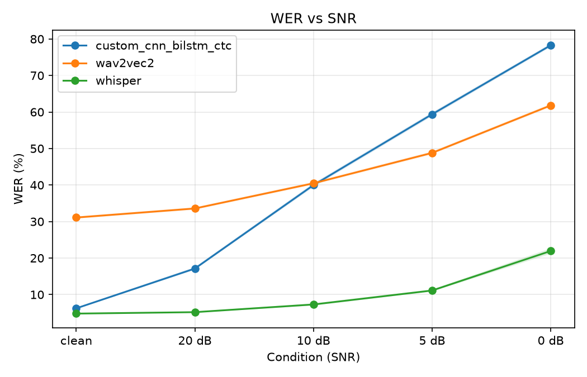
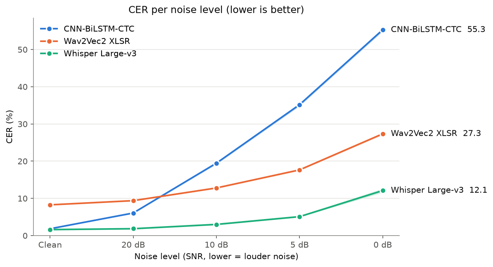
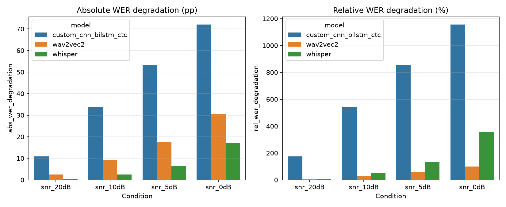
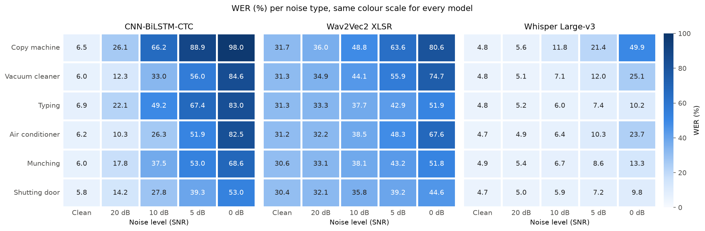
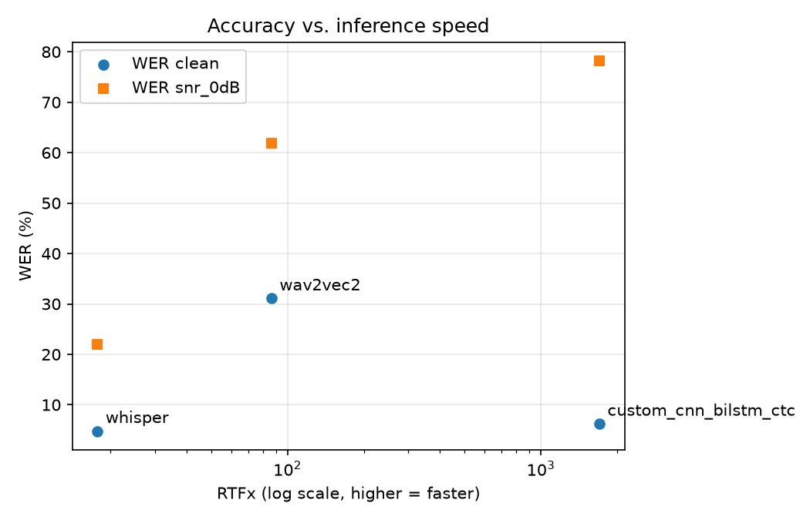
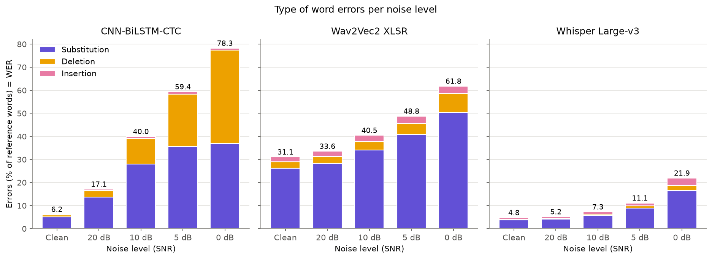

# Evaluating Noise Robustness in Indonesian ASR

Comparative study of Indonesian automatic speech recognition (ASR) under environmental noise:
**clean vs. noisy speech** at controlled signal-to-noise ratios (SNR).

| Model | Input path | Role |
|---|---|---|
| Custom CNN-BiLSTM-CTC | 80-bin log-Mel filterbank (frozen in `config/config.yaml`) | Trained from scratch on the official training split |
| [Wav2Vec2 XLSR Indonesian](https://huggingface.co/indonesian-nlp/wav2vec2-large-xlsr-indonesian) | Raw waveform via the checkpoint's processor | Pretrained, evaluated without fine-tuning |
| [Whisper Large-v3](https://huggingface.co/openai/whisper-large-v3) | Log-Mel via the checkpoint's processor, `language=indonesian`, `task=transcribe` | Pretrained, evaluated without fine-tuning |

Conditions: **Clean, 20 dB, 10 dB, 5 dB, 0 dB**. Metrics: WER, CER, absolute/relative WER degradation, RTFx.

> **Status: complete.** The pilot (small training batch: 30 test utterances x 5 conditions) was run on a laptop
> (RTX 3050, 4 GB). The training of the custom model and the full test (15,673 utterances x 5 conditions) were run
> on Kaggle (Tesla T4, 16 GB): see [Full runs on Kaggle](#full-runs-on-kaggle). Results are summarized
> [below](#results); the full analysis is in [`report/results_analysis.md`](report/results_analysis.md).

## Research questions

**Primary:** How does environmental noise at different SNR levels affect Indonesian ASR performance, and which evaluated model is most robust?

1. How large is the WER/CER increase from clean to noisy speech?
2. Does the ranking of models change across SNR levels?
3. Do different environmental noise categories affect the models differently?

## Results

Full test set: 15,673 utterances per condition, the same noisy inputs for every model. WER % (CER % in brackets).
The 95 % bootstrap confidence intervals are within ±0.8 pp (`summary_by_model_condition.csv`).

| Model | Clean | 20 dB | 10 dB | 5 dB | 0 dB | RTFx (T4) |
|---|---|---|---|---|---|---|
| Custom CNN-BiLSTM-CTC | 6.23 (1.84) | 17.12 (6.07) | 39.97 (19.46) | 59.38 (35.16) | 78.27 (55.28) | **1,703** |
| Wav2Vec2 XLSR Indonesian | 31.10 (8.27) | 33.58 (9.39) | 40.47 (12.80) | 48.80 (17.66) | 61.80 (27.35) | 86.5 |
| Whisper Large-v3 | **4.79** (1.62) | **5.18** (1.85) | **7.29** (3.01) | **11.11** (5.10) | **21.94** (12.11) | 17.8 |

**Most robust: Whisper Large-v3.** It has the lowest WER and CER in every condition and the smallest absolute
degradation. The custom model's clean result is optimistic: every test sentence also occurs in the training split,
spoken by other speakers (see [Limitations](#limitations)).





### RQ1: How large is the increase from clean to noisy speech?

Noise raises the WER of every model. The pretrained models change little at 20 dB and degrade faster at low SNR.
The custom model already loses 10.9 pp at 20 dB and about 20 pp more at each further step. From clean to 0 dB the
WER rises by 72.0 pp for the custom model, 30.7 pp for Wav2Vec2 and 17.1 pp for Whisper. Wav2Vec2 has the smallest
*relative* increase only because its clean WER is already high.



### RQ2: Does the ranking change across SNR levels?

| Condition | 1st | 2nd | 3rd |
|---|---|---|---|
| Clean, 20 dB | Whisper | CNN-BiLSTM-CTC | Wav2Vec2 |
| 10 dB | Whisper | CNN-BiLSTM-CTC | Wav2Vec2 (0.5 pp behind: a tie) |
| 5 dB, 0 dB | Whisper | Wav2Vec2 | CNN-BiLSTM-CTC |

Partly: Whisper is first in every condition, while second and third place swap at about 10 dB (the two lines cross
in the plot above).

### RQ3: Do noise categories affect the models differently?

Copy-machine noise is the hardest and a shutting door the easiest for every model (0 dB: 98.0 / 80.6 / 49.9 % vs
53.0 / 44.6 / 9.8 % WER for CTC / Wav2Vec2 / Whisper). How much each noise type hurts, and the order of the other
categories, differs between the custom model and the pretrained ones. All panels use the same colour scale.



### Accuracy vs speed

No model is best at both. Whisper is the most accurate but about 96 times slower than the custom model and needs
the most GPU memory (7.7 GB vs 0.23 GB). The line between the two points of a model shows how much it loses at 0 dB.



### How the models fail

In loud noise the custom model mostly drops words (deletions), Wav2Vec2 misspells words even on clean audio
(substitutions), and Whisper mostly substitutes, with rare repetition loops at 0 dB.



Paired model differences with confidence intervals, per-speaker results and example transcripts:
[`report/results_analysis.md`](report/results_analysis.md).

## Full runs on Kaggle

On the 4 GB laptop GPU, Whisper Large-v3 fits only at batch size 1 and runs at about real time (~88 GPU-hours for
the full test set). With the lecturer's approval, the training and the full test were therefore run on Kaggle, with
all three models on the same Tesla T4 GPU so that RTFx stays comparable. This repository holds the code, the pilot
and the downloaded results. The notebooks show the runs with their logs and outputs:

| Notebook | What it does | Code commit | Run |
|---|---|---|---|
| [aol-dl-data](https://www.kaggle.com/code/darrenvincent/aol-dl-data) | Downloads both datasets, runs the audit and checks the result is identical to the laptop | `e55a836` | CPU |
| [aol-dl-train-cnn-bilstm-ctc](https://www.kaggle.com/code/darrenvincent/aol-dl-train-cnn-bilstm-ctc) | Downloads and checks the data again, then trains the custom model | [`6f22cc7`](https://github.com/Maesticc/Evaluating-Noise-Robustness-in-Indonesian-ASR/tree/6f22cc7ea763270d2b00ddcb240685a0048745a3) | T4, 7.1 h (48 epochs) |
| [evaluating-noise-robustness-in-indonesian-asr](https://www.kaggle.com/code/darrenvincent/evaluating-noise-robustness-in-indonesian-asr) | Checks data and model, repeats the pilot and compares it with the laptop, then runs and evaluates the full test | [`ce13344`](https://github.com/Maesticc/Evaluating-Noise-Robustness-in-Indonesian-ASR/tree/ce13344706adeb57410848e8e6c3661c10a80c1f) | T4, 7.3 h (one session) |

- Each notebook clones this repository (branch `dev_darren`) when it runs and calls the same `python -m src...`
  commands as the [Pipeline](#pipeline). Only the paths in `config.yaml` point to Kaggle folders, and Whisper uses
  batch size 16 instead of 1. The configuration used is saved in [`output/kaggle/config_kaggle_test.yaml`](output/kaggle/config_kaggle_test.yaml).
- Pinned versions: speech dataset Hugging Face commit `97a862f`, MS-SNSD commit `fe61c4b`, Wav2Vec2 `68fbcbd`,
  Whisper `06f233f`. A notebook stops if the downloaded data, the audited file lists (sha256) or the trained model
  (sha256 `4222c1ba…`) differ from the laptop.
- The pilot repeated on Kaggle matches the laptop: identical noise pairing, identical transcripts for CTC (150/150) and
  Whisper (150/150, batch 16 vs 1), and 147/150 for Wav2Vec2 with the same WER ([`PILOT_CHECK.json`](output/kaggle/PILOT_CHECK.json)).
  Re-running `src.evaluate` locally on the downloaded predictions reproduces every result table.
- Environment on Kaggle: Python 3.13, PyTorch 2.11 (CUDA 13.0), transformers 5.23.0, jiwer 4.0.0.
  Laptop: Python 3.12, PyTorch 2.11 (CUDA 12.6), transformers 5.23.0.
- **Versions on Kaggle:** Version 1 of each notebook is the run, with its output and logs, and is shown by default.
  Version 3 is the same code with shorter comments, saved without running (Version 2 is an intermediate tidy-up).
- **Running a notebook again** clones the latest code on `dev_darren`. Since the runs above, the code changed only
  in plot styling, comments and the added analysis script, and these changes were checked to give identical results.

## Datasets

| Dataset | Used for | Not used for |
|---|---|---|
| [Indonesian-ASR-11-Class-Dataset](https://huggingface.co/datasets/Atika88/Indonesian-ASR-11-Class-Dataset) (CC BY 4.0, DOI 10.57967/hf/10345) | Indonesian speech, reference transcripts, speaker metadata, official speaker-disjoint `train/val/test` splits | Noise bank |
| [MS-SNSD](https://github.com/microsoft/MS-SNSD) (`noise_train/`, `noise_test/`) | Environmental (non-speech) noise for controlled mixing | Speech or Indonesian transcripts |

- Raw data are **not** committed. Download them with step 1 of the [Pipeline](#pipeline):
  - speech goes to `data/raw/indonesia_asr/`, and the category tar files are extracted there so `audio_path` in the metadata resolves
  - noise goes to `data/raw/ms_snsd/` (sparse clone of the two noise folders only)
  - the resolved version is written to `DOWNLOAD_INFO.json` in each folder
- MS-SNSD licence (per its README): the noise comes from Freesound (CC0) and DEMAND (CC BY-SA 3.0); the source of each file is not specified upstream.
- `metadata/dataset_metadata_public.csv` is the source of truth for paths, transcripts, speakers and splits. Official splits are never reshuffled.
- The 132 synthetic repair files (`is_synthetic == True`) are excluded from the primary evaluation (`speech_audit.exclude_synthetic`).
- Speech-like noise categories (`Babble`, `NeighborSpeaking`, `AirportAnnouncements`) are excluded. In `noise_test` the neighbour recordings are named `Neighbor_*.wav`; they are mapped to `NeighborSpeaking` and excluded too. Ambience categories that may contain background talk (Cafe, Restaurant, Station, ...) stay in `review` and are not used; they only exist in `noise_train`.
- Music is out of scope (`noise_audit.include_music: false`); the study covers non-speech environmental noise only.
- Checkpoints were verified on Hugging Face before use: both accept 16 kHz mono input through their official processor, list Indonesian (`id`) as a supported language, and are openly licensed (`indonesian-nlp/wav2vec2-large-xlsr-indonesian` Apache-2.0, `openai/whisper-large-v3` Apache-2.0). The exact versions are pinned by their Hugging Face commit in `config.yaml` (Wav2Vec2 `68fbcbd`, Whisper Large-v3 `06f233f`) and written to every `run_*.json`.
- Evaluation uses the `noise_test` pool. `noise_train` is reserved for the optional noise-augmentation experiment and for the validation development subset (same six categories). No noise file appears in both pools, and test noise is never used for a protocol or checkpoint decision.
- The corpus is prompted/read speech with a fixed sentence inventory (213 distinct sentences, and every test sentence also appears in the training split); conclusions are limited to this corpus and the selected noise conditions.

### Audit results

Audit run on all 104,500 speech files and 179 noise files (`speech_audit_summary.json`, `noise_manifest.csv`).

| Split | Speakers | Files | Invalid | Eligible for the primary experiment |
|---|---|---|---|---|
| train | 28 | 73,150 | 41 | 72,987 |
| val | 6 | 15,675 | 2 | 15,665 |
| test | 3 human (M4, M8, M12) + 1 synthetic | 15,675 | 0 | 15,673 |

- Every file is readable, non-empty, 16 kHz mono and has a transcript. Duration: median 4.5 s, 99.9th percentile 11.3 s, maximum 206 s.
- Files outside the audit thresholds were flagged `review` and resolved by the documented rules in `speech_audit.auto_review`
  instead of per-file listening:
  - *Clipping* (1,138 files, mild: median 0.25 % clipped samples, concentrated in a few recording sessions): accepted below 1 %, excluded at 1 % or more (32 files, all in train).
  - *Duration 1.5–15 s or speaking rate 5–30 characters/s* (26 files): the speaking rate is recomputed over the active-speech span. Between 3 and 30 characters/s the file is accepted (it only had extra silence); otherwise it is excluded (11 files: extra or wrong content, or truncated audio).
- `audit_flags` lists every automatic flag a file received. `exclusion_reason` is filled only for files that are not valid.
  Decisions in `manual_review_decisions.csv` override the rules.
- Noise used for evaluation: 29 `noise_test` files in 6 categories (AirConditioner 9, Munching 7, ShuttingDoor 8,
  CopyMachine 2, Typing 2, VacuumCleaner 1). Byte-identical noise files are detected: `noise_train/AirConditioner_2` and
  `noise_train/SqueakyChair_3` are the same recording with different labels, so both are excluded. Two evaluation files
  flagged by the speech check (see Limitations) are excluded as a precaution.

### Manifests

Manifests are tables (CSV) that list every file with its details; the scripts read them instead of scanning folders.
They are in `data/processed/manifests/`. The large ones are git-ignored and regenerated by the scripts.

| File | Content |
|---|---|
| `speech_manifest_raw.csv` | Metadata projection: audio_path, transcript, speaker_id, official_split, duration_sec, sample_rate, is_synthetic |
| `speech_manifest.csv` | The raw manifest plus audit statistics, `quality_status` (valid/review/invalid), `audit_flags`, `auto_review` (rule decision with measured values), `exclusion_reason`, `eligible_primary` |
| `noise_manifest.csv` | noise_path, noise_category, duration_sec, sample_rate, quality_status, audit_flags, exclusion_reason, `content_md5` / `duplicate_of` (byte-identical files), provenance_note |
| `manual_review_decisions.csv` | Manual overrides of the audit: `manifest,id,decision,note` |
| `noise_speech_check.csv` | Valid noise files screened for speech with Wav2Vec2: transcript, letters per second, `speech_suspected` |
| `conditions_<split>[_pilot].csv` | One row per utterance and condition: noise file, offset, seed, target/achieved SNR, output gain, clipping flags. Every noisy waveform is regenerated from it |
| `speech_audit_summary.json` | Duration/RMS distribution, status counts, auto-review counts, flags raised, exclusion reasons |

## Repository structure

```
data/
  raw/indonesia_asr/        # HF dataset snapshot + extracted audio (not committed)
  raw/ms_snsd/              # sparse clone of MS-SNSD noise folders (not committed)
  processed/manifests/      # audit, split, pairing and SNR manifests
  processed/pilot_cache/    # optional pilot WAVs for listening (not committed)
notebooks/
  exploration.ipynb         # dataset audit and EDA
  experiments.ipynb         # listen to pilot mixtures
src/
  data_loader.py            # download, metadata, audio loading, manifests
  audio_validation.py       # integrity, duration, silence/RMS, clipping, valid/review/invalid
  preprocessing.py          # deterministic text normalization
  noise_mixing.py           # noise selection, SNR mixing, achieved-SNR verification
  model_loader.py           # the three models behind one transcribe() interface
  custom_cnn_bilstm_ctc.py  # custom model architecture
  train_custom_model.py     # training on the official train split (val for selection)
  inference.py              # predictions, runtime and configuration per model
  evaluate.py               # WER, CER, degradation, RTFx, tables and plots
  analysis.py               # error types, paired model differences, noise ranking, per speaker
  utils.py                  # config, seeds, logging, environment info
config/config.yaml          # all experiment settings
output/
  predictions/              # predictions, run metadata and result tables per tag (test_pilot, test)
  plots/                    # plots per tag
  kaggle/                   # status, pilot check and configuration of the Kaggle full test
  models/, logs/            # checkpoints and logs (not committed)
tests/                      # unit tests: normalization, SNR mixing, metrics, resume, analysis, config
report/
  results_analysis.md       # answers to the research questions
  whisper_model_selection.md
```

The final report and presentation also go in `report/`; their tables and figures come from `output/`.

## Pipeline

Run all commands from the repository root. Steps 5 and 6 were run on Kaggle for the full study (see above).

```bash
# 0. Unit tests (no data or GPU needed)
python -m pytest -q tests

# 1. Download data
python -m src.data_loader download-speech                      # all categories (~134 h of audio)
#    or: python -m src.data_loader download-speech --categories Declarative   (quick start)
python -m src.data_loader download-noise

# 2. Build raw manifests (speech + noise) and check speaker-disjoint splits
python -m src.data_loader build-manifests

# 3. Audit. Inspect the duration distribution first, then set thresholds in config.yaml
python -m src.audio_validation --target speech --summary-only
python -m src.audio_validation --target all                    # ~13 min for the full corpus
python -m src.audio_validation --target noise-speech           # screen valid noise files for speech (Wav2Vec2)
#    To override a decision, add a row to data/processed/manifests/manual_review_decisions.csv and re-run the audit.

# 4. Pilot (small training batch): 30 test utterances, all SNRs
python -m src.noise_mixing build-pairs --split test --pilot
python -m src.noise_mixing export-pilot                         # WAVs for listening
python -m src.inference --pilot --models wav2vec2 whisper
python -m src.evaluate --pilot --models wav2vec2 whisper

# 5. Train the custom model (train split; val for early stopping/checkpoint selection)
python -m src.train_custom_model [--max-hours H]
#    an interrupted run continues with --resume (after the last finished epoch)
python -m src.inference --pilot --models custom_cnn_bilstm_ctc
python -m src.evaluate --pilot
python -m src.analysis --pilot

# 6. Full comparison
python -m src.noise_mixing build-pairs --split test
python -m src.inference [--max-hours H]                         # an interrupted run continues with --resume
python -m src.evaluate
python -m src.analysis
```

## Experimental protocol

**Noise mixing** (`src/noise_mixing.py`)
- `SNR(dB) = 10·log10(P_speech / P_noise)`. Speech power is measured over active-speech frames (25 ms / 10 ms frames within 40 dB of the loudest frame). Noise power is measured over the full added segment.
- The noise segment is cropped (or tiled if shorter) from a seeded offset. The same noise file and offset are reused for every SNR of an utterance.
- Noise categories are assigned round-robin so each category gets a similar number of utterances.
- Clipping protection (`mixing.gain_scope: utterance`): impulsive noise (Typing, CopyMachine, Munching) can push a mixture above full scale. One output gain per utterance, taken from its loudest mixture, is applied to speech and noise in all five conditions, clean included. The SNR is unchanged and the speech component is identical across conditions, so conditions differ only in noise level. In the full test, 8,581 of 15,673 utterances were attenuated (at most −27.5 dB). The gain is recorded per row.
- The achieved SNR is recalculated for every mixture and checked against a 0.1 dB tolerance (full test: maximum error 0.0000 dB, no residual clipping).
- Mixing is deterministic and on the fly. The conditions manifest stores the noise file, offset, seed, target/achieved SNR, gain and clipping flags.

**Fair comparison**
- All models use the same test utterances, noise segments, SNR targets and normalization. `evaluate.py` scores only rows present for every model.
- The pretrained models are not fine-tuned in the primary experiment. The custom model uses only the training split. The validation split is used for checkpoint selection, and the test set is not used for tuning.
- Every noisy variant stays in its utterance's official split.
- Whisper is Large-v3 as planned; the smaller fallback of plan 7.3 was not needed ([`report/whisper_model_selection.md`](report/whisper_model_selection.md)).

**Custom CNN-BiLSTM-CTC decisions** (frozen before training; `config.yaml` → `models.custom_cnn_bilstm_ctc`, `src/custom_cnn_bilstm_ctc.py`)
- Input: 80-bin log-Mel filterbank, 16 kHz, 25 ms window (`n_fft` 400), 10 ms hop, per-utterance normalization.
- Tokens: character vocabulary built from the normalized training transcripts; index 0 is the CTC blank.
- Acoustic model (4.4 M parameters): two 3×3 Conv2d layers (32, 32 channels; stride (2, 2) then (2, 1), BatchNorm, GELU; strided convolution instead of pooling, so time is downsampled 2×), dropout 0.2, a linear projection to 256, then a 3-layer BiLSTM (256 hidden per direction), linear output.
- Padding: packed sequences with per-utterance output lengths. Decoding: CTC greedy.
- Training: AdamW (lr 5e-4, weight decay 1e-5), one-cycle schedule, batch 16, gradient clipping 5.0, mixed precision, at most 50 epochs, early stopping after 5 epochs without improvement in CER on a fixed-seed 2,000-utterance validation subset.
- Training data are shuffled with seed 42 + epoch number. After every epoch the full training state (model, optimizer, learning-rate schedule, early-stopping counter) is saved to `last.pt`, so an interrupted run continues with `--resume` on the same data order and schedule. A resumed run was checked against an uninterrupted one: the losses agree to the fourth decimal place (GPU arithmetic is not bit-exact).
- Result (Kaggle T4, all 72,987 training utterances): early stopping after 48 epochs (8.9 min per epoch, 7.1 h), best epoch 43 with validation WER 2.32 % and CER 0.69 %. The validation sentences also occur in the training split, so these numbers are optimistic.

**Text normalization** (`preprocessing.normalize_text`, used for both references and hypotheses): NFKC, lowercase, `%` → `persen`, digits → Indonesian words (`2018` → `dua ribu delapan belas`), hyphens → spaces, accent stripping, punctuation removal, whitespace collapse. No stemming or lemmatization. Original transcripts are never modified.

**Timing:** `time.perf_counter` around model inference with CUDA synchronization. Warm-up batches and waveform generation are excluded. The hardware, the software versions and the Git commit of the code (with `git_code_changed` if `src/` or `config/` had uncommitted changes) are written to `output/predictions/run_*.json`. Predictions are saved after every batch, so a run stopped by a time limit continues with `--resume`.

## Outputs

`<tag>` is `test_pilot` (pilot) or `test` (full test).

- `output/predictions/predictions_<tag>_<model>.csv`: per-utterance hypotheses and timing; `run_<tag>_<model>.json`: model, hardware, software and code version of the run
- `output/predictions/results_<tag>/summary_by_model_condition.csv`: WER/CER with 95 % bootstrap CI, ΔWER, relative degradation, RTFx
- `output/predictions/results_<tag>/summary_by_model_noise_category.csv` and `model_rank_by_condition.csv`
- `output/predictions/results_<tag>/rtfx.csv`: RTFx per model with checkpoint and revision, precision, device, GPU, batch size, peak GPU memory and library versions
- `output/predictions/results_<tag>/accuracy_vs_speed.csv`: WER per condition against RTFx
- `output/predictions/results_<tag>/clean_mismatch_candidates.csv`: possible transcript/audio mismatches (reported, not excluded)
- `output/predictions/results_<tag>/analysis/`: error types, paired model differences, noise-category ranking, per-speaker WER, examples and the longest outputs (`src.analysis`)
- `output/plots/<tag>/`: WER and CER vs SNR, WER degradation, WER heatmap by noise category, accuracy vs speed, error types
- `output/kaggle/`: `TEST_STATUS.json`, `PILOT_CHECK.json` and the configuration of the Kaggle full test
- `data/processed/manifests/noise_speech_check.csv`: valid noise files screened for speech (letters per second that Wav2Vec2 transcribes; flagged at 4 or more)

## Limitations

- This is a practical comparison between a custom model trained on this corpus and two pretrained models used without fine-tuning, not an architecture-only comparison with identical training exposure. Fine-tuning or noise-augmented training, if done later, is reported as a separate secondary experiment.
- The speech is prompted/read, and every test sentence also occurs in the training split. The custom model has therefore seen the test sentences (spoken by other speakers), while the pretrained models have not. These results do not measure open-vocabulary or spontaneous-speech performance.
- The test split has only three human speakers, all male (M4, M8, M12). Results may not transfer to female speakers. All six clean utterances that every model gets badly wrong (`clean_mismatch_candidates.csv`) are from M8.
- The bootstrap confidence intervals treat utterances as independent although they share 3 speakers and 209 sentences, so they are optimistic. Small gaps, such as the 0.5 pp between CTC and Wav2Vec2 at 10 dB, should be read as ties.
- The references write "dimana" where the pretrained models usually write the standard "di mana" (2.4 % of utterances, about 0.4 pp clean WER for Whisper and Wav2Vec2). The normalization was fixed before any results and is not adjusted afterwards; no ranking changes.
- The noise conditions are limited to six audited MS-SNSD categories, one of which (VacuumCleaner) has a single recording. The noise is added digitally, not recorded together with the speech.
- Deviation from the plan (sections 5, 5.1, 5.2): files were not checked by listening. Automatic checks are used instead:
  - Speech-like noise is excluded by category, and speech review cases are resolved by the documented rules above.
  - Transcript/audio mismatches: `src.evaluate` lists clean utterances whose CER is at least 30 % for every model in `clean_mismatch_candidates.csv` (full test: 6 utterances, reported, not removed).
  - Speech inside the noise files: Wav2Vec2 transcribes every valid noise file (`--target noise-speech`). Wav2Vec2 also outputs letters for pure noise, so the threshold (4 letters per second) was calibrated on the 57 MS-SNSD files that certainly contain speech: it catches 91 % of them. The speech in those files is English, so counting Indonesian words does not work. Result: 11 of 112 valid noise files are flagged, 2 of them in the evaluation pool (`noise_test/AirConditioner_3` and `noise_test/Munching_6`). Rule: every flagged evaluation file is excluded as a precaution (recorded in `manual_review_decisions.csv`), leaving 29 evaluation noise files. Flagged `noise_train` files are only reported; that pool is not used in the primary experiment.
- RTFx compares practical set-ups: each model ran at a batch size and precision that fit and are efficient on the T4 (CTC fp32 batch 16, Wav2Vec2 fp32 batch 8, Whisper fp16 batch 16). Wav2Vec2 transcripts are not bit-identical between GPUs (147 of 150 pilot rows identical, same WER).

## References

- Indonesian-ASR-11-Class-Dataset, DOI [10.57967/hf/10345](https://doi.org/10.57967/hf/10345)
- C. K. A. Reddy et al., "A Scalable Noisy Speech Dataset and Online Subjective Test Framework," Interspeech 2019 (MS-SNSD)
- [indonesian-nlp/wav2vec2-large-xlsr-indonesian](https://huggingface.co/indonesian-nlp/wav2vec2-large-xlsr-indonesian)
- [openai/whisper-large-v3](https://huggingface.co/openai/whisper-large-v3)
- [JiWER](https://github.com/jitsi/jiwer)
