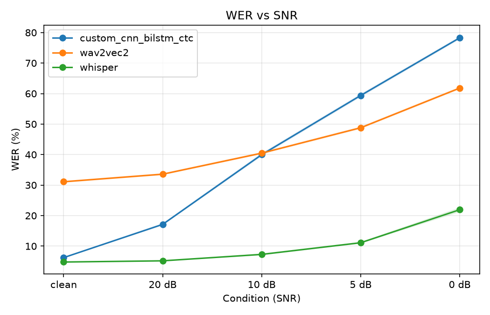
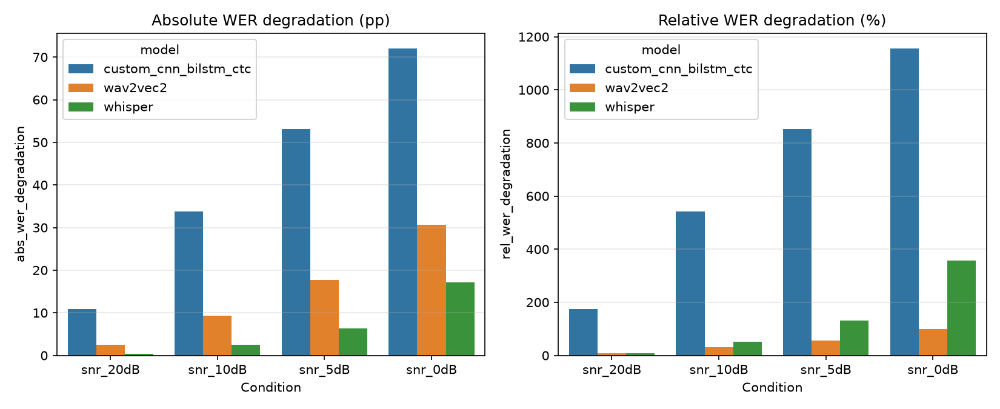
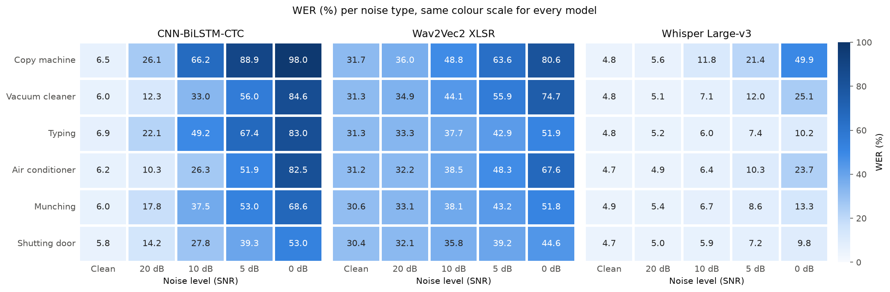
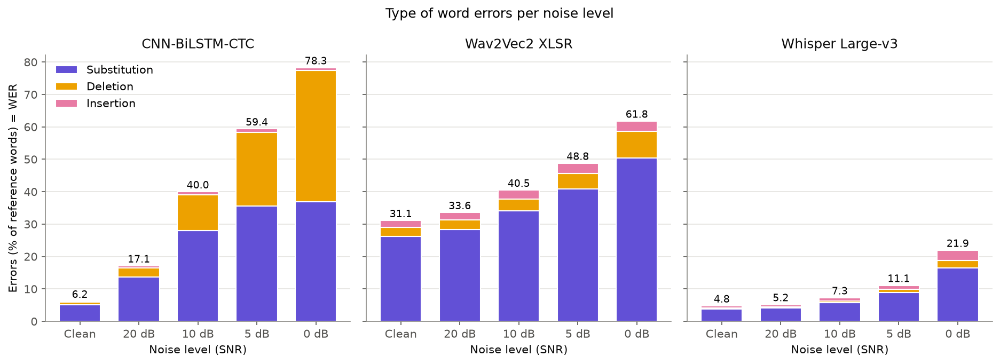
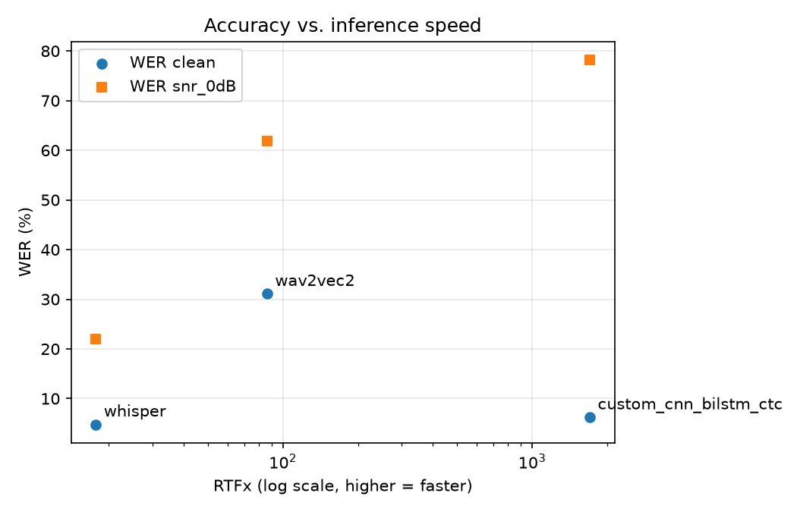

# Results analysis: full test set

Answers to the research questions from the full test run. Every number comes from files in the repository:

- `output/predictions/results_test/` (written by `python -m src.evaluate`)
- `output/predictions/results_test/analysis/` and `output/plots/test/error_types.png` (written by `python -m src.analysis`)
- `output/plots/test/` (plots)

## 1. What was run

| Item | Value |
|---|---|
| Test set | 15,673 utterances (official test split): 3 speakers (M4, M8, M12, all male), 209 different sentences |
| Conditions | Clean, 20, 10, 5, 0 dB. Each utterance is mixed with one noise file from one of 6 categories, reused at every SNR |
| Rows per model | 15,673 × 5 = 78,365 (94.7 h of audio); 0 failed rows for every model |
| Models | CNN-BiLSTM-CTC (trained from scratch, best epoch 43), Wav2Vec2 XLSR Indonesian and Whisper Large-v3 (pretrained, no fine-tuning, pinned revisions) |
| Hardware | Kaggle, one NVIDIA Tesla T4 (16 GB); one session of 7.3 h; code commit `ce13344` |
| Metrics | Corpus-level WER and CER; 95 % CI by bootstrap over utterances (1,000 resamples); model differences by paired bootstrap |

**Reproducibility checks.** Before the full run, the 150-row small training batch was repeated on Kaggle and compared with the laptop run:
- The noise pairing (noise file, offset, gain) was identical.
- Transcripts were identical for CTC (150/150) and Whisper (150/150, even with batch 16 instead of 1).
- Wav2Vec2 matched on 147 of 150 rows, with the same WER (CER +0.05 pp at 5 and 0 dB), which is GPU arithmetic noise.
- Re-running `src.evaluate` locally on the Kaggle predictions reproduces every result table exactly.

## 2. Main results

WER (%) with 95 % CI:

| Model | Clean | 20 dB | 10 dB | 5 dB | 0 dB |
|---|---|---|---|---|---|
| CNN-BiLSTM-CTC | 6.23 [6.04, 6.43] | 17.12 [16.79, 17.52] | 39.97 [39.43, 40.49] | 59.38 [58.82, 59.89] | 78.27 [77.80, 78.71] |
| Wav2Vec2 XLSR | 31.10 [30.76, 31.41] | 33.58 [33.23, 33.91] | 40.47 [40.10, 40.84] | 48.80 [48.39, 49.21] | 61.80 [61.39, 62.21] |
| Whisper Large-v3 | **4.79** [4.65, 4.93] | **5.18** [5.03, 5.34] | **7.29** [7.01, 7.58] | **11.11** [10.84, 11.40] | **21.94** [21.17, 22.67] |

CER (%):

| Model | Clean | 20 dB | 10 dB | 5 dB | 0 dB |
|---|---|---|---|---|---|
| CNN-BiLSTM-CTC | 1.84 | 6.07 | 19.46 | 35.16 | 55.28 |
| Wav2Vec2 XLSR | 8.27 | 9.39 | 12.80 | 17.66 | 27.35 |
| Whisper Large-v3 | **1.62** | **1.85** | **3.01** | **5.10** | **12.11** |

## 3. RQ1: How large is the WER/CER increase from clean to noisy speech?

Increase in WER compared with the clean audio of the same utterances: absolute (percentage points) and, in brackets, relative.

| Model | 20 dB | 10 dB | 5 dB | 0 dB |
|---|---|---|---|---|
| CNN-BiLSTM-CTC | +10.9 (+175 %) | +33.7 (+542 %) | +53.1 (+853 %) | **+72.0** (+1156 %) |
| Wav2Vec2 XLSR | +2.5 (+8 %) | +9.4 (+30 %) | +17.7 (+57 %) | **+30.7** (+99 %) |
| Whisper Large-v3 | +0.4 (+8 %) | +2.5 (+52 %) | +6.3 (+132 %) | **+17.1** (+358 %) |

- Every model gets worse as the noise gets louder.
  - For Wav2Vec2 and Whisper the loss grows faster with every step down in SNR, with the largest step between 5 and 0 dB.
  - The custom model already loses a lot at 20 dB, and loses about 20 pp more at each further step.
- **Mild noise (20 dB):** almost no effect on Whisper (+0.4 pp) or Wav2Vec2 (+2.5 pp). The custom model already loses 10.9 pp.
- **Loudest noise (0 dB):** the custom model loses 72 pp and gets about 4 out of 5 words wrong. Wav2Vec2 loses 31 pp and Whisper 17 pp.
- CER shows the same pattern. From clean to 0 dB, CER rises by 53.4 pp for CTC, 19.1 pp for Wav2Vec2 and 10.5 pp for Whisper.

**Absolute vs relative degradation.** Wav2Vec2 has the smallest *relative* increase, but only because its clean WER is already high (31 %). Doubling 31 % costs more words than quadrupling 4.8 %. For a listener, the number of words lost (absolute degradation) and the final error rate are what matter, so robustness is judged on those.

## 4. RQ2: Does the ranking of models change across SNR levels?

Rank by WER (1 = best) and the paired difference between models (WER of the first model minus the second, 95 % CI):

| Condition | 1st | 2nd | 3rd | CTC − Wav2Vec2 | CTC − Whisper | Wav2Vec2 − Whisper |
|---|---|---|---|---|---|---|
| Clean | Whisper | CTC | Wav2Vec2 | −24.9 [−25.2, −24.6] | +1.4 [+1.2, +1.7] | +26.3 [+26.0, +26.6] |
| 20 dB | Whisper | CTC | Wav2Vec2 | −16.5 [−16.8, −16.1] | +11.9 [+11.6, +12.3] | +28.4 [+28.1, +28.7] |
| 10 dB | Whisper | CTC | Wav2Vec2 | **−0.5 [−1.0, −0.04]** | +32.7 [+32.1, +33.3] | +33.2 [+32.8, +33.6] |
| 5 dB | Whisper | Wav2Vec2 | CTC | +10.6 [+10.1, +11.1] | +48.3 [+47.7, +48.8] | +37.7 [+37.3, +38.1] |
| 0 dB | Whisper | Wav2Vec2 | CTC | +16.5 [+16.1, +16.9] | +56.3 [+55.5, +57.1] | +39.9 [+39.1, +40.6] |

- **First place does not change.** Whisper is best in every condition, and every difference involving Whisper is clearly outside sampling noise.
- **Second and third place swap at about 10 dB.**
  - With clean audio and mild noise, the custom model is far ahead of Wav2Vec2.
  - At 10 dB the two are practically tied: 0.5 pp apart, with a CI that only just excludes zero.
  - From 5 dB on, Wav2Vec2 is clearly better.
- So the answer is **yes, partly**: the overall winner is the same, but the order of the other two depends on the noise level.
- **Clean audio, Whisper vs CTC.** On clean audio Whisper beats the custom model by 1.4 pp. In the small training batch (30 utterances) the custom model was slightly ahead (6.02 vs 6.35 %). That sample was too small to rank models this close together.

## 5. RQ3: Do noise categories affect the models differently?

WER per noise category (same colour scale for all models; *Clean* is the clean WER of the utterances that were mixed with that category):

**What all models agree on.**
- **Copy machine** is the hardest noise for every model at every SNR. At 0 dB it gives 98.0 % WER for CTC, 80.6 % for Wav2Vec2 and 49.9 % for Whisper.
- **Shutting door** is the easiest at every SNR for Wav2Vec2, for Whisper from 10 dB down, and for CTC at 5 and 0 dB. At 0 dB it gives 53.0 %, 44.6 % and 9.8 %.
- The gap between the hardest and easiest category grows as the noise gets louder:

  | Model | 20 dB | 10 dB | 5 dB | 0 dB |
  |---|---|---|---|---|
  | CNN-BiLSTM-CTC | 15.8 pp | 39.9 pp | 49.6 pp | 45.0 pp |
  | Wav2Vec2 XLSR | 4.0 pp | 13.0 pp | 24.4 pp | 35.9 pp |
  | Whisper Large-v3 | 0.8 pp | 5.8 pp | 14.2 pp | 40.2 pp |

  At 0 dB, Whisper's WER is five times higher with a copy machine than with a door.

**Where they differ** (`analysis/noise_category_ranking.csv`):
- **Typing** is the second-hardest noise for the custom model at 20 to 5 dB. For Wav2Vec2 and Whisper at 10 to 0 dB it is the second- or third-easiest.
- **Air conditioner** is the easiest noise for the custom model at 20 and 10 dB. For Wav2Vec2 and Whisper at 5 and 0 dB it is the third-hardest.

**A likely explanation (not tested here).** SNR is defined on the *average* noise power.
- Impulsive noises (door, typing, munching) put that energy into short bursts, so most of the speech stays clean between the bursts.
- Continuous broadband noises (copy machine, vacuum cleaner, air conditioner) cover the speech all the time.
- The pretrained models appear to use the clean gaps. The custom model, trained on clean speech only, is also hurt by short bursts.

**Answer:** yes. The hardest and easiest noises are largely shared, but how much a noise type hurts differs strongly between models, and the order of the middle categories differs between the custom model and the pretrained ones.

## 6. Primary question: which model is most robust?

**Whisper Large-v3 is the most robust model.** It has the lowest WER and CER in every condition and the smallest absolute degradation at every SNR. It also has the most perfectly transcribed utterances under noise: 37.7 % at 0 dB, against 1.5 % for Wav2Vec2 and 3.3 % for CTC.

The custom CNN-BiLSTM-CTC is the *least* robust, even though it is competitive on clean audio. Section 9 explains why its clean result is optimistic.

## 7. How the models fail

Word errors split into substitutions (wrong word), deletions (missing word) and insertions (extra word). The three rates add up to the WER.

| Model | Condition | Substitution | Deletion | Insertion | Words written / words spoken |
|---|---|---|---|---|---|
| CNN-BiLSTM-CTC | Clean | 5.1 | 1.0 | 0.2 | 0.99 |
| CNN-BiLSTM-CTC | 0 dB | 36.9 | **40.5** | 0.9 | **0.60** |
| Wav2Vec2 XLSR | Clean | **26.2** | 2.8 | 2.1 | 0.99 |
| Wav2Vec2 XLSR | 0 dB | 50.3 | 8.2 | 3.2 | 0.95 |
| Whisper Large-v3 | Clean | 3.7 | 0.4 | 0.7 | 1.00 |
| Whisper Large-v3 | 0 dB | 16.5 | 2.4 | 3.1 | 1.01 |

- **The custom model goes quiet in noise.**
  - At 0 dB it writes only 60 % as many words as were spoken, and deletions become its largest error type.
  - It returns an empty transcript for 1.8 % of the utterances.
  - What it does write is mostly broken words, for example "amuja aai" for "tolong jadwalkan penandatanganan mou dengan perguruan tinggi mitra".
- **Wav2Vec2 spells words wrong even on clean audio.**
  - Its clean CER is low (8.3 %) but its WER is high (31.1 %): most words are nearly right but misspelled, for example "jawalkan", "pengapus", "jengaragu".
  - Only 11 % of clean utterances are perfect, against 73 % for CTC and 72 % for Whisper.
  - The model has no language model to correct spelling, and nothing was fine-tuned on this corpus.
- **Whisper mostly substitutes.** Rarely, in loud noise, it repeats a phrase in a loop, for example "saya buat aja aja aja …" for a 9-word sentence. This happens for 19 utterances at 0 dB (0.12 %) but produces up to 28 times as many words as were spoken. These loops cause 5.5 % of Whisper's errors at 0 dB; without them its 0 dB WER would be 20.8 % instead of 21.9 %. No conclusion changes.

Three random utterances with every model's output in every condition are listed in `analysis/examples.csv`.

## 8. Accuracy versus speed

Measured on the same Kaggle T4 GPU. RTFx is seconds of audio transcribed per second of compute (higher = faster). Time covers model inference only.

| Model | Parameters | Precision, batch | RTFx | Time for the 94.7 h test set | Peak GPU memory |
|---|---|---|---|---|---|
| CNN-BiLSTM-CTC | 4.4 M | fp32, 16 | **1,703** | **3.3 min** | **0.23 GB** |
| Wav2Vec2 XLSR | ~0.3 B | fp32, 8 | 86.5 | 66 min | 3.29 GB |
| Whisper Large-v3 | 1.55 B | fp16, 16 | 17.8 | 5.3 h | 7.73 GB |

- No model is best at both.
  - Whisper is the most accurate and the most robust, but about 96 times slower than the custom model and needs the most GPU memory.
  - The custom model is very fast and small, and good on clean audio, but breaks down in noise.
  - Wav2Vec2 sits in the middle on speed and is the least accurate on clean audio. It is better than the custom model only at 5 dB and below.
- The hardware matters. On the 4 GB laptop GPU (RTX 3050), Whisper fits only at batch size 1 and runs at about real time (small training batch: RTFx 1.08). That is roughly 88 h for the full test set, which is why the full run was done on Kaggle.
- Batch size and precision differ between the models (each was run at a setting that fits and is efficient), so the RTFx values compare practical set-ups rather than identical ones.

## 9. Things that limit the interpretation

1. **The custom model has seen every test sentence.**
   - The whole corpus has only 213 different sentences, each read many times by every speaker.
   - All 209 test sentences also occur in the training split, spoken by other speakers (the speakers themselves do not overlap: 14 for training, 3 for validation, 3 for testing).
   - The custom model therefore learned to recognise a closed set of sentences. Its clean WER (6.2 %) is not a measure of general Indonesian ASR.
   - The pretrained models never saw these sentences.
   - The clean comparison favours the custom model. Its drop in noise also reflects its training data (clean speech only, no noise augmentation), not only its architecture.
2. **Few speakers.**
   - Only three test speakers, all male. Every model is best on M12 and worst on M8, for example clean WER for Whisper is 3.4 % on M12 and 6.3 % on M8, and for CTC 0.3 % and 13.7 % (`analysis/by_speaker.csv`).
   - All six clean utterances that every model gets badly wrong (`clean_mismatch_candidates.csv`) are from M8. At least one of them contains a second sentence that is not in its transcript.
   - These utterances are reported, not removed.
3. **The confidence intervals are optimistic.** The bootstrap resamples utterances as if they were independent, but they share 3 speakers and 209 sentences. Small gaps, such as the 0.5 pp at 10 dB between CTC and Wav2Vec2, should be read as ties.
4. **Spelling conventions.**
   - The references write "dimana", while Whisper and Wav2Vec2 usually write the standard "di mana", which counts as 2 word errors.
   - This affects 2.4 % of the utterances. Counting "di mana" as correct would lower the clean WER by 0.4 pp for Whisper and Wav2Vec2.
   - No ranking changes. The normalisation was fixed before any results and is not adjusted afterwards.
5. **Synthetic noise from a limited set.** The noise is added digitally, not recorded together with the speech. There are 29 evaluation noise files in 6 categories, and *VacuumCleaner* has a single recording.
6. **Pretrained models are used as they are.** There is no fine-tuning and no external language model, as the plan specifies. Fine-tuning, or training the custom model with noise augmentation, would likely change the picture and would be a separate experiment.

## 10. Summary

- **RQ1:** Noise raises WER for every model. The pretrained models degrade slowly at first and faster at low SNR; the custom model degrades steeply from 20 dB on. From clean to 0 dB: +72 pp for CNN-BiLSTM-CTC, +31 pp for Wav2Vec2 XLSR, +17 pp for Whisper Large-v3.
- **RQ2:** Whisper is first in every condition. The custom model is second down to 10 dB, where it ties with Wav2Vec2. Wav2Vec2 is second from 5 dB on.
- **RQ3:** Copy machine noise is the hardest and a shutting door the easiest for all models. However, the size of the effect, and the order of the other categories, differ between the custom model and the pretrained models.
- **Most robust:** Whisper Large-v3. It is also the slowest and needs the most memory. The custom model is the fastest by far and good on clean audio, but its clean result benefits from having seen the test sentences, and it is the least robust to noise.

**Regenerate:** `python -m src.evaluate` then `python -m src.analysis` (add `--pilot` for the small training batch).
